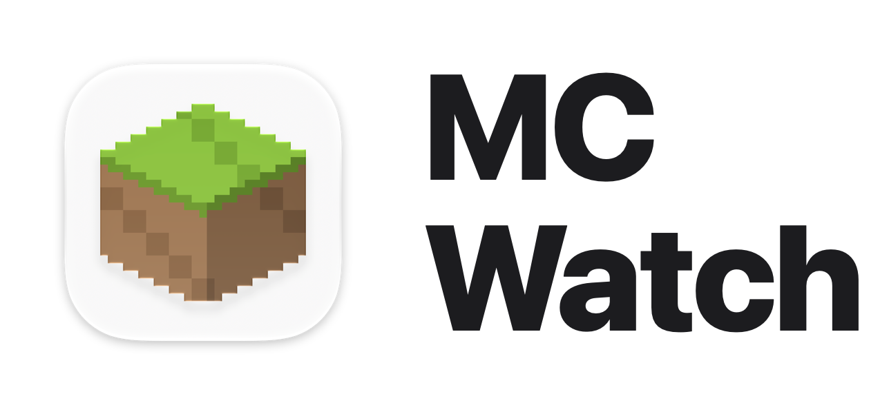
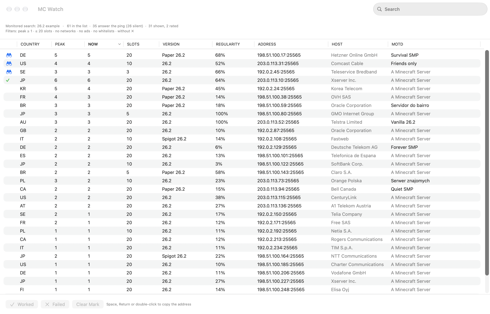
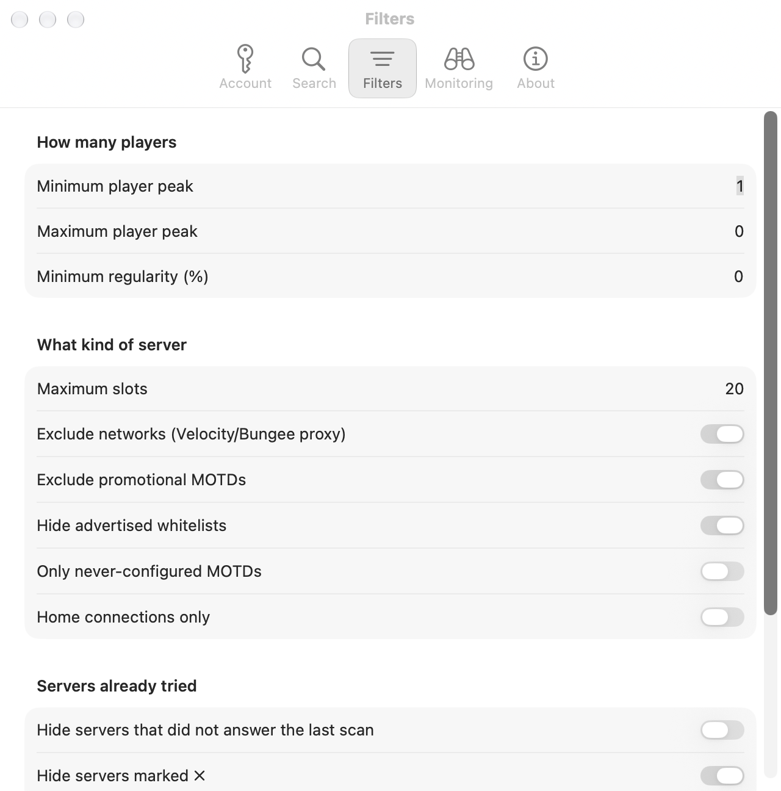

<div align="center">

<picture>
  <source media="(prefers-color-scheme: dark)" srcset="docs/banniere-sombre.png">
  
</picture>

**Search, watch and join home Minecraft servers with players from other countries.**

A native macOS app, written entirely in Swift.

</div>

## What it does

MC Watch turns a Shodan search into a list it keeps watching. Every ten minutes
each server is pinged again with the standard Server List Ping, and the answer
is kept. After a day you know which servers have players, at what hours, and
how many.

You can then filter on all of that: player peak, how often a server is
populated, slots, version, promotional MOTD, home connection or datacenter —
and more to come. Servers you try can be marked ✓ or ✗ depending on whether you
liked them, and those marks follow the address across every list.
You can also watch addresses you type yourself, on their own schedule.

**Java Edition only.** The ping speaks the Java protocol over TCP, so searches
are restricted to port 25565 — Bedrock answers RakNet over UDP.

<picture>
  <source media="(prefers-color-scheme: dark)" srcset="docs/capture-sombre.png">
  
</picture>

> [!WARNING]
> Everything in these screenshots is made up. The addresses are the
> documentation-only ones reserved by RFC 5737. MC Watch never publishes the
> addresses it finds.

<picture>
  <source media="(prefers-color-scheme: dark)" srcset="docs/capture-filtres-sombre.png">
  
</picture>

## Requirements

- macOS 27 or later, Apple Silicon.
- A Shodan API key, from [account.shodan.io](https://account.shodan.io).

**YOU WILL NEED A SHODAN MEMBERSHIP FOR THIS SOFTWARE TO BE OF ANY USE.**

A free account gives you a key but no query credits, and without credits you
cannot create a single list. Membership is a one-time purchase and includes 100
credits a month.

A list costs one credit per hundred servers: **three for the default size, ten
for the largest**. The price is on the button before you spend anything.
Everything after that is free — the ten-minute pings never touch Shodan.

Watching servers you add yourself needs no key at all: that part never touches
Shodan.

## Install

1. Download the `.dmg` from the [releases page](../../releases).
2. Drag the app to Applications.
   Background monitoring does not survive being run from a disk image or from
   Downloads.
3. Open it once. macOS shows an alert and refuses.
4. System Settings → Privacy & Security → **Open Anyway**.

Notarization requires the paid developer program; this is signed with a free
Apple Development certificate. To check what you downloaded:

```bash
codesign -dv --verbose=4 "/Applications/MC Watch.app"
```

Team `CT2VKA6A5C`, a hardened runtime, and a timestamp — the timestamp keeps the
signature valid after the certificate expires in August 2027.

The app is sandboxed. It asks for network access, the sandbox itself, read
access to a file you pick in the open panel, and a mach-lookup exception for the
updater. Nothing else.

If it refuses to open, or monitoring will not start on your machine, please open
an issue.

## Updates

MC Watch runs its automatic updates through
[Sparkle](https://sparkle-project.org).

- **MC Watch → Check for Updates…** asks straight away.
- **Settings → About → Updates**: check automatically, and install without
  asking.

It fetches [`appcast.xml`](appcast.xml), in this repository. Every release is
signed with an EdDSA key whose public half is compiled into the app; anything
that does not match is refused.

## Build it yourself

```bash
git clone https://github.com/Minortos/MCWatch.git
cd MCWatch
./construire.sh
```

Xcode 27 or later. The script compiles, builds the icon, assembles the bundle
into `/Applications/MC Watch.app` and signs it. The first build downloads
Sparkle.

A free Apple Development certificate is enough (Xcode → Settings → Accounts →
Manage Certificates → `+`). **Without one, the script signs ad-hoc and says so:
the app works, but the background agent will not stay alive.** If your keychain
holds several identities, it picks by team identifier and prints which.

```bash
swift test
```

No setup, no network, no credits. See [CONTRIBUTING](CONTRIBUTING.md).

## What's next

No dates promised. In rough order of intent:

- **One list instead of many**, to watch every server at once.
- **Bedrock**, over RakNet.
- **Export** the list as it is filtered in .txt on your computer.
- **Notifications** when a watched server changes.
- **Send an address straight to a Minecraft instance.**
- **Clean out** servers that never come back.

## Privacy

Three things leave your Mac: the Shodan API calls, the pings, and the update
check.

- Your API key lives in your login keychain. Each user of the Mac has their own.
- Lists and history stay in
  `~/Library/Containers/com.minortos.mcwatch.app/Data/`.
- No analytics, no crash reporting. The update check sends nothing about you.

## Non-goals

MC Watch only asks servers the question they already answer publicly. It will
never gain:

- any way to bypass a whitelist, a ban, or a password;
- any authentication attempt, credential guessing, or exploit;
- any feature for publishing or sharing the addresses it finds;
- higher scan rates.

Pull requests adding any of these will be closed.

## Translations

English, French, German, Spanish, Italian, Portuguese (Brazil), Dutch, Polish,
Russian and Turkish. Everything except English and French was machine-translated
and is marked "needs review" — see [CONTRIBUTING](CONTRIBUTING.md).

## Disclaimer

This describes MC Watch as it is today, not a contract with its future. If a
feature worth having contradicts something written above — I reserve the right to change
it.

What does not change: any such shift ships as a new version, in this
repository, under the GPL. You can read what changed, and you can stay on the
version you have.

## Credits and legal

Server discovery uses the [Shodan](https://www.shodan.io) API. You need your own
key; MC Watch never redistributes Shodan data.

Updates use [Sparkle](https://sparkle-project.org), copyright © 2006 Andy
Matuschak and contributors, under the MIT licence, with portions of bsdiff under
a BSD licence. Its full notice ships inside the app.

**NOT AN OFFICIAL MINECRAFT PRODUCT. NOT APPROVED BY OR ASSOCIATED WITH MOJANG
OR MICROSOFT.**

Written and coded with Claude, under my direction and testing.

Copyright © 2026 Minortos. Licensed under the **GNU General Public License,
version 3 or later** — see [LICENSE](LICENSE). You may use, study, modify and
redistribute it freely; a modified version you distribute stays under the GPL
and carries its source.
